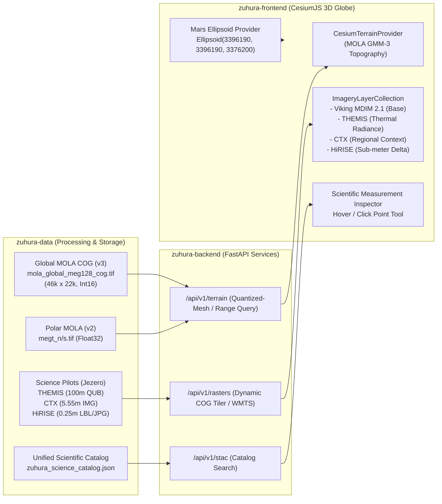

# Zuhura Mars Digital Twin — CesiumJS Scientific Data Integration Contract

**Document Version:** 1.0.0  
**Target Consumer:** `zuhura-frontend` (CesiumJS 1.120+ / React 19)  
**Provider:** `zuhura-backend` & `zuhura-data`  
**Reference Geodetic Model:** IAU/IAG 2015 WGCCRE Mars Biaxial Ellipsoid ($a=3,396,190\text{ m}, c=3,376,200\text{ m}$)  
**Topographic Vertical Datum:** MOLA GMM-3 Areoid

---

## 1. Overview and Architecture

This contract establishes the formal specification for how the **Zuhura Cesium 3D Globe** (`zuhura-frontend`) will request, render, and interpret planetary datasets processed and validated by `zuhura-data` and served via `zuhura-backend`.



---

## 2. Terrain Specification

Cesium requires an authoritative ellipsoidal surface and a vertical displacement field.

### 2.1 Cesium Globe Ellipsoid Definition
```javascript
// Native Cesium Ellipsoid configuration for Mars
const marsEllipsoid = new Cesium.Ellipsoid(
    3396190.0, // X-axis (Equatorial radius a in meters)
    3396190.0, // Y-axis (Equatorial radius a in meters)
    3376200.0  // Z-axis (Polar radius c in meters)
);
```

### 2.2 Global Topography (MOLA COG v3)
- **File Asset:** `data/processed/mola/global_v3/mola_global_meg128_cog.tif`
- **Native Grid:** $46,080 \times 22,528$ pixels ($463.0577\text{ m/px}$).
- **Elevation Units:** Meters above the MOLA GMM-3 areoid potential datum.
- **Elevation Range:** $-8,208\text{ m}$ (Hellas Basin) to $+21,249\text{ m}$ (Olympus Mons).
- **Data Type:** `Int16`.
- **NoData Rule:** `None`. 
  > [!IMPORTANT]
  > Elevation of exactly `0` meters is a **valid areoid datum pixel** (136,772 pixels globally). The frontend must NOT treat `0` as transparency or void.
- **Coverage Latitudes:** $-88.0^\circ\text{ to }+88.0^\circ$ planetocentric.

### 2.3 Polar Topography (MOLA Polar v2)
- **North Pole:** `megt_n_128_1.tif` ($+87.0^\circ\text{ to }+90.0^\circ\text{ N}$, Float32 physical meters).
- **South Pole:** `megt_s_128_1.tif` ($-90.0^\circ\text{ to }-87.0^\circ\text{ S}$, Float32 physical meters).
- **NoData Convention:** Value `-99999.0` represents pixels outside the polar stereographic circular observation disc. Cesium terrain shaders must clamp or discard tiles with elevation $\le -90000.0$.

---

## 3. Scientific Imagery & Layer Visualization Rules

The frontend must **never treat all visual layers as interchangeable RGB pictures**. Each planetary instrument observes a different physical phenomenon.

| Layer Name | Native Scale | Physical Phenomenon | Units | Frontend Visualization Rule |
| :--- | :---: | :--- | :--- | :--- |
| **Viking MDIM 2.1** | $231.5\text{ m}$ | Visible Albedo (RGB Proxy) | 8-bit DN | Global base imagery layer. |
| **THEMIS IR RDR** | $100.0\text{ m}$ | Calibrated Thermal Infrared Radiance | $W\cdot m^{-2}\cdot sr^{-1}\cdot \mu m^{-1}$ | **False-color scientific colormap** (e.g. Plasma, Inferno, Turbo) representing radiance. **Must display quantitative hover tool** with physical units, NOT "RGB(240, 10, 50)". |
| **CTX EDR** | $5.55\text{ m}$ | High-contrast Panchromatic Geomorphology | 8-bit DN | Monochrome grayscale overlay. Contrast stretched for regional morphology. |
| **HiRISE RDR** | $0.25\text{ m}$ | Sub-meter Surface Structure & Outcrops | Calibrated $I/F$ | True-scale high-resolution overlay. Displayed when camera altitude $\le 50\text{ km}$. |

### 3.1 Strict Prohibition against Data Misrepresentation
1. **Radiance vs. Temperature:** THEMIS `IRRDR` observations contain **spectral radiance**, not kinetic surface temperature. The frontend UI must label this layer as *"THEMIS Calibrated Infrared Radiance ($W/(m^2\cdot sr\cdot \mu m)$)"*, unless a Planck inversion or thermal inertia model is explicitly computed.
2. **Sub-meter Claims:** Sub-meter rendering is ONLY valid within the footprints of verified HiRISE products (e.g., Jezero Western Delta). The UI must state the active layer's ground sampling distance (GSD).

---

## 4. Scientific Catalog Access API Contract

The frontend queries `zuhura-backend` for available observations using STAC-compatible endpoints:

### 4.1 Bounding Box Spatial Search
```http
GET /api/v1/catalog/search?bbox=76.5,18.0,78.5,19.0&family=themis,ctx,hirise HTTP/1.1
Host: api.zuhura.space
Accept: application/json
```

**Expected Response Schema:**
```json
{
  "type": "FeatureCollection",
  "features": [
    {
      "type": "Feature",
      "id": "zuhura-themis-ir-jezero",
      "geometry": {
        "type": "Polygon",
        "coordinates": [[[76.815, 24.494], [78.507, 12.485], [77.952, 12.452], [76.207, 24.458], [76.815, 24.494]]]
      },
      "properties": {
        "instrument": "THEMIS",
        "mission": "2001 Mars Odyssey",
        "product_id": "I02413002RDR",
        "resolution_m": 100.0,
        "acquisition_time": "2002-07-01T05:28:53.115Z",
        "physical_quantity": "Spectral Radiance",
        "units": "W/(m^2*sr*um)",
        "validation_status": "scientifically_validated"
      },
      "assets": {
        "browse": { "href": "/rasters/themis/I02413002.png", "type": "image/png" },
        "spectral_cube": { "href": "/rasters/themis/I02413002RDR.QUB", "type": "application/octet-stream" }
      }
    }
  ]
}
```

### 4.2 Point Elevation Lookup (FastAPI Range Read)
```http
GET /api/v1/elevation?lat=18.38&lon=77.58 HTTP/1.1
Host: api.zuhura.space
Accept: application/json
```

**Response:**
```json
{
  "latitude": 18.38,
  "longitude": 77.58,
  "elevation_m": -2648,
  "vertical_datum": "MOLA GMM-3 Areoid",
  "source_product": "mola_global_meg128_cog",
  "uncertainty_m": 1.0
}
```

---

## 5. Multi-Scale Layered Pyramid Hierarchy (Jezero Testbed)

When zooming into Jezero Crater in Cesium, the frontend layer switcher shall activate data in progressive tiers:

```
Altitude > 1,500 km   : Viking Global MDIM 2.1 (232 m/px) + Global MOLA COG Overview (Level 7)
Altitude 150 - 1,500 km: THEMIS Thermal IR Corridor (100 m/px) + MOLA Full Resolution (463 m/px)
Altitude 20 - 150 km  : CTX Western Fan Delta Corridor (5.55 m/px)
Altitude < 20 km      : HiRISE Western Fan Delta Deposits (0.25 m/px Sub-meter Outcrops)
```

---

## 6. Frontend Geodesy Checklist

Before integrating scientific tiles, verify in `zuhura-frontend`:
- [ ] Biaxial ellipsoid semi-major axis is exactly $3,396,190.0\text{ m}$.
- [ ] Biaxial ellipsoid semi-minor axis is exactly $3,376,200.0\text{ m}$.
- [ ] Longitudes are positive-East ($0^\circ\text{ to }360^\circ$ or $-180^\circ\text{ to }+180^\circ$).
- [ ] Zero elevation is rendered at the areoid datum, not masked as void.
- [ ] THEMIS layers feature a quantitative color legend in $W/(m^2\cdot sr\cdot \mu m)$.
